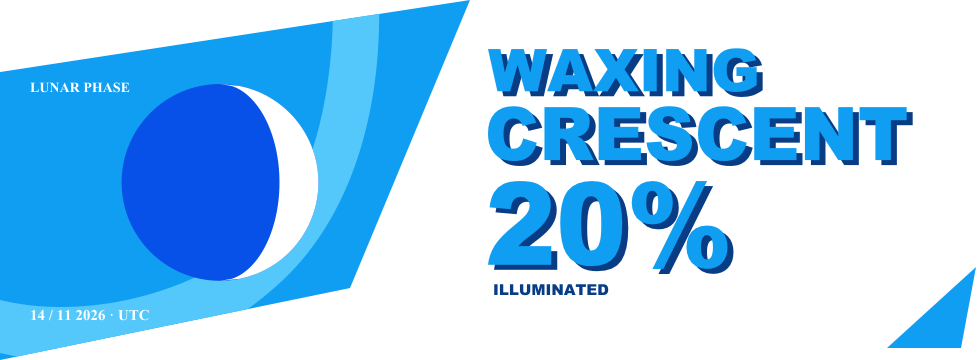

Curious about how things work and how things are made.

Exploring open source, learning by building, experimenting, and contributing along the way.

Into technology, video games, films, and the ideas behind the things we create.

### Today's moon phase

<picture>
  <source media="(prefers-color-scheme: dark)" srcset="./assets/lunar-status-dark.svg">
  <source media="(prefers-color-scheme: light)" srcset="./assets/lunar-status-light.svg">
  
</picture>

Updated daily · Approximate geocentric model · 00:00 UTC

