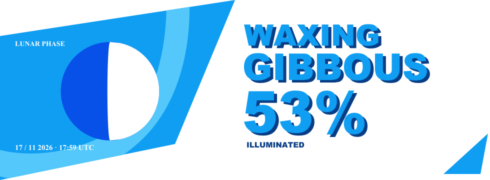

Curious about how things work and how things are made.

Exploring open source, learning by building, experimenting, and contributing along the way.

Into technology, video games, films, and the ideas behind the things we create.

### Today's moon phase

<picture>
  <source media="(prefers-color-scheme: dark)" srcset="./assets/lunar-status-dark.svg">
  <source media="(prefers-color-scheme: light)" srcset="./assets/lunar-status-light.svg">
  
</picture>

Scheduled every 12 hours · Astronomy Engine · UTC time shown on card

<!-- The card is a geocentric snapshot, not a location-specific view of the sky.
GitHub Actions scheduling and image caching can delay updates.
Principal phase names use a ±1° longitude window; other times use crescent/gibbous names. -->
